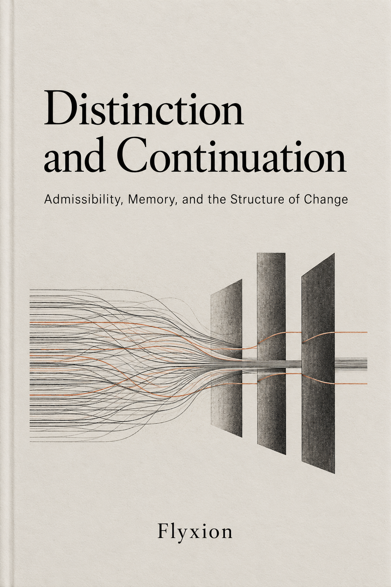
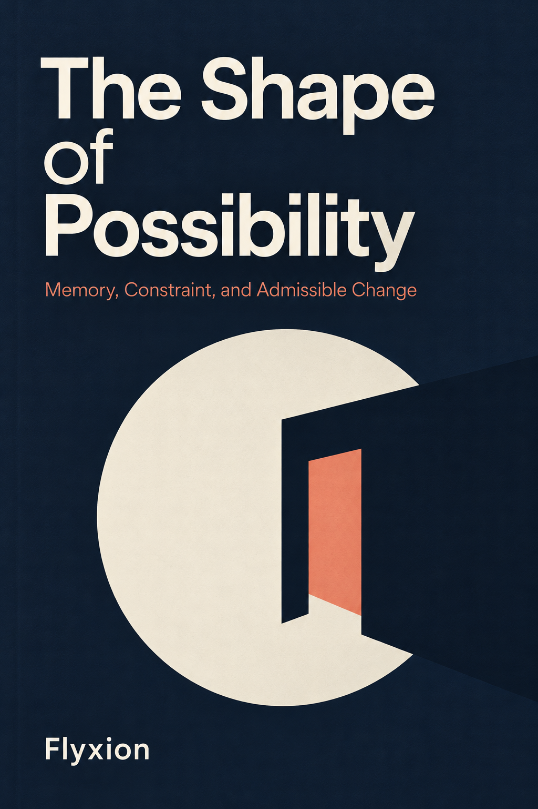

# Persistent Distinctions

Two paired graduate textbooks in LaTeX, written as one project with a shared common model and a shared proof spine.

## The two volumes

**Distinction and Continuation: Admissibility, Memory, and the Structure of Change** (Book 1, `book1-distinction-continuation.tex`) establishes what a system must retain and what it must distinguish. It treats histories, continuation equivalence and quotients, adequacy and sufficiency, fixed and varying policies, incremental maintenance, products, approximation, verification, provenance, retrieval, admissibility, obligations, identity, disposition, degradation, compensation, distributed quotas, interfaces and delegation, revision, and cost. It has 24 chapters and appendices A to F, and closes with worked systems and open problems.

**The Shape of Possibility: Memory, Constraint, and Admissible Change** (Book 2, `book2-shape-of-possibility.tex`) takes the retained structure as given and develops reachability, dynamics and cost: viability kernels, Markov decision processes and partial observability, Petri nets, history-state representations (rate limits are anchored at Chapter 7), irreversibility, counting, costs, robustness, obligations, fallback and relegation, interfaces, revision, proxies, exploration, the cost of sufficiency, and architecture. It has 24 chapters and appendices A to G. Appendix A (sufficiency) is written so that the second volume can be read without the first.

## Common model

Both volumes use the same objects: histories, a representation, a physical state map, obligations, and an admissibility relation, together with three obstructions (physical, obligation, representational). The files `common-model.tex` and `division-of-labour.tex` fix the notation and say which volume owns which result.

## Result statuses

Every statement carries one of three statuses. **Established** results cite a source. **New** results are proved under an explicit `\assumes` line. A **proof obligation** is a claim stated precisely whose proof is not yet supplied. `proof-spine.tex` lists the results by number and status.

## Building

Keep all files in one directory, because the style file and chapters are found by relative path. Run `pdflatex` three times on each main file. The `examples/` folder holds the scripts used in Book 1 Appendix E, and the numerical examples in both books were checked with scripts of this kind.

## State of the drafts

Both volumes are complete first drafts that compile without errors. Book 2 has had a close reading of its numerical examples, assumptions and proofs, and the corrections from that reading are applied. Book 1 has had a new section and three new exercises added to each of Chapters 1 to 22 and a final section in Chapter 23. Chapter 24 has only one edit, a citation of the new threshold result in its first open problem. Each added number was checked by script, and statements that are only computed (not proved) are labelled as computations in the text.

## What remains

1. **Book 1 appendices.** Check Appendices A to F against the expanded chapters, in particular the examples in Appendix E and the recap in Appendix F, and confirm that its statement of the division between the volumes still matches the text.
2. **Cross-references between volumes.** Reconcile every reference of the form "Chapter N of the second volume" and "Chapter N of the first volume" against the implemented chapter lists. The known anchors are rate limits at Book 2 Chapter 7 and obligations and degradation at Book 1 Chapters 14 and 17.
3. **Proof spine.** Update `proof-spine.tex` for the Book 2 corrections (row S74 still reflects the earlier rover example) and add rows for the new Book 1 results.
4. **Selective deepening of both books.** Extended worked examples, counterexamples that isolate which assumption a theorem needs, exercises with genuinely different proof demands, and a hints-and-solutions appendix. Chapter 23 of Book 1 and the Book 2 sufficiency appendix are the first candidates.
5. **Proof obligations.** Convert or discharge those still open, starting with the minimal-monitor claim for two obligations on a shared clock (computed for deadlines up to 7, not proved).
6. **Attribution and bibliography.** Check every attribution against its source before the bibliography is assembled.
